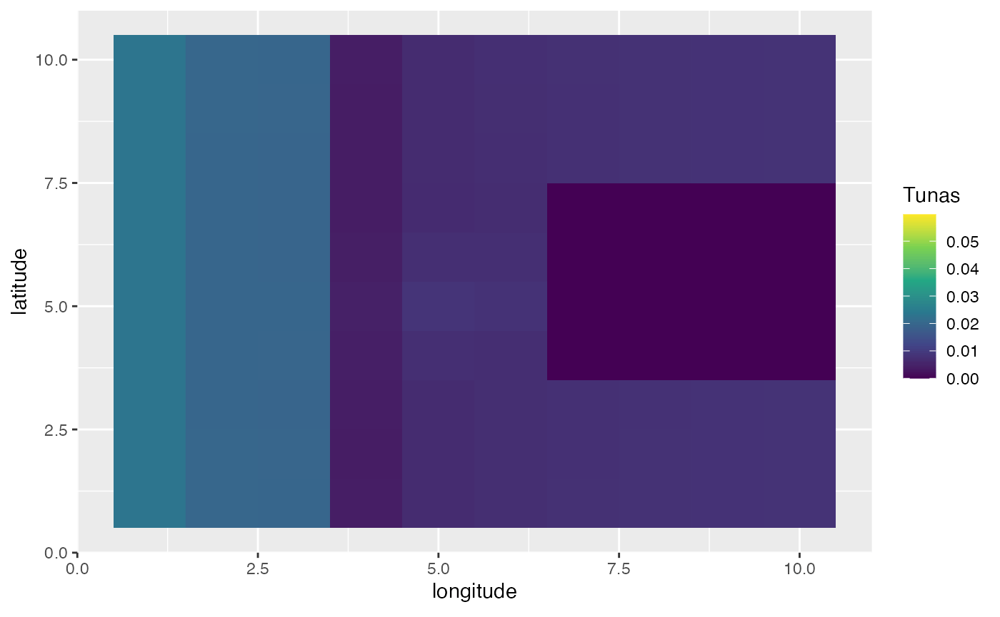
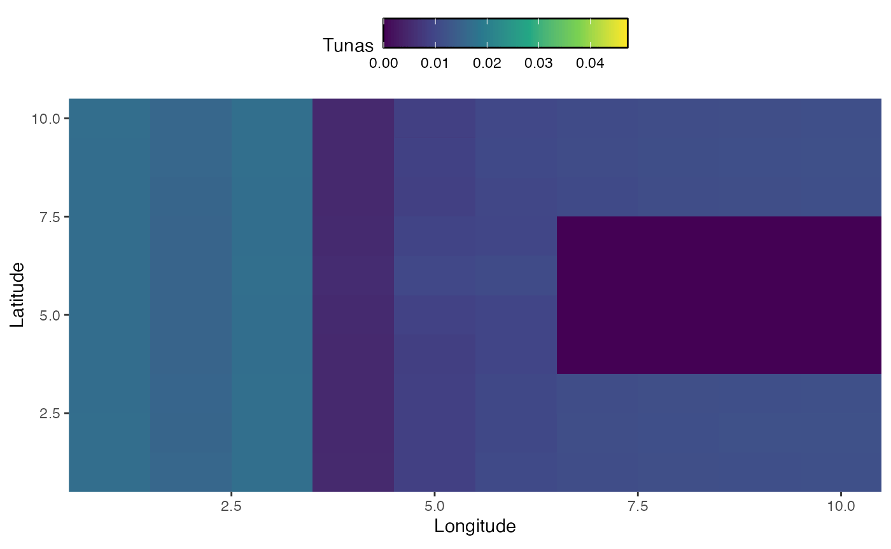

```{r, include = FALSE}
knitr::opts_chunk$set(
  collapse = TRUE,
  comment = "#>",
  message = FALSE,
  warning = FALSE
)
```

Along with allowing users to create simulation where habitat varies in space, or where regulations vary in space, you can also allow for habitat that changes in time, either cyclically or with a trend. 

## Spawning Aggregations

In this first example, we'll create a scenario where the year is split up into four seasons. In this simulation, bigeye tuna spend half the season in the far "east" of the domain, and half the season concentrated on a spawning ground where spawning occurs. 

As an added twist, you can add landmasses to your model by setting the habitat value to `NA` in the patches covered by land. This is different than setting habitat to 0, as a zero value simply implies that organisms don't want to live in that patch, where land prohibits them from passing over or through those cells. 

By default if the length of the habitat vectors is less than the time steps, the model treats the supplied habitat list as being seasonal.

### A note on habitat orientation

marlin reads a habitat matrix exactly as it looks when you print it: **row 1 is the top of the map** (`y = ny`), the last row is `y = 1`, and column `j` is `x = j`. Good habitat in the top-left of the matrix puts fish in the top-left of the output. That is how a GIS raster stores a map (row 1 = north) and how `image()` and `plot.matrix` draw one, so a raster read straight off disk needs no flipping, and `create_critter()` and `simmar()` both use this same convention.

The catch shows up when you *generate* habitat from a formula, as we do below. `expand_grid()` runs `y` bottom-up like a Cartesian axis, while a matrix runs top-down, so you have to `arrange(desc(y))` before reshaping to a matrix. Skip it and the surface goes in upside down: `y` in your formula ends up meaning the opposite of `y` on the map, and a range shift you wrote to move north will move south instead.

Note that a surface which is symmetric in `y` (a `dnorm` centred on the grid) or which ignores `y` entirely is identical either way — so an orientation mistake stays invisible until you use an asymmetric surface. Worth checking with one deliberately.

```{r setup}
library(marlin)

library(tidyverse)

library(gganimate)

library(ggridges)

library(gifski)

years <- 20

resolution <- 10

seasons <- 4

steps <- years * seasons

time_step <- 1 / seasons

land <- expand_grid(x = 1:resolution, y = 1:resolution) %>%
  filter(between(x, 7, 10) & between(y, 4, 7)) %>%
  mutate(land = TRUE)


h1 <- expand_grid(x = 1:resolution, y = 1:resolution) %>%
  mutate(habitat = dnorm(x, resolution / 2, .02 * resolution) * dnorm(y, resolution / 2, .02 * resolution)) %>%
  mutate(habitat = habitat * (x >= 4)) %>%
  left_join(land, by = c("x", "y")) %>%
  mutate(habitat = ifelse(is.na(land), habitat, NA)) %>%
  select(-land)


h2 <- expand_grid(x = 1:resolution, y = 1:resolution) %>%
  mutate(habitat = -.5 * x + 10) %>%
  mutate(habitat = habitat * (x < 4)) %>%
  left_join(land, by = c("x", "y")) %>%
  mutate(habitat = ifelse(is.na(land), habitat, NA)) %>%
  select(-land)


# marlin reads habitat matrices as they look when printed: row 1 is the TOP of
# the map (y = ny). expand_grid() runs y bottom-up, so arrange(desc(y)) before
# reshaping, or the surface goes in upside down and `y` in the formulas above
# means the opposite of `y` on the map.
bigeye_habitat <- h1 %>%
  arrange(desc(y)) %>%
  pivot_wider(names_from = x, values_from = habitat) %>%
  select(-y) %>%
  as.matrix()


# huh <- tidyr::pivot_longer(as.data.frame(bigeye_habitat), tidyr::everything())
#
# h1$habitat2 <- as.numeric(huh$value)

bigeye_habitat2 <- h2 %>%
  arrange(desc(y)) %>%
  pivot_wider(names_from = x, values_from = habitat) %>%
  select(-y) %>%
  as.matrix()

recruit_habitat <- bigeye_habitat

recruit_habitat[!is.na(recruit_habitat)] <- 1

fauna <-
  list(
    "bigeye" = create_critter(
      scientific_name = "thunnus obesus",
      habitat = list(bigeye_habitat, bigeye_habitat2),
      season_blocks = list(c(1, 2), c(3, 4)),
      adult_home_range = c(5, 5), # standard deviation of the number of patches moved by adults
      recruit_home_range = 10,
      recruit_habitat = recruit_habitat,
      density_dependence = "pre_dispersal",
      seasons = seasons,
      init_explt = 1,
      explt_type = "f",
      spawning_seasons = c(2, 3),
      sigma_rec = 0,
      ac_rec = 0,
      linf = 100,
      vbk = 0.2,
      age_mature = 4,
      m = 0.2,
      weight_a = 1e-4,
      weight_b = 3,
      max_age = 15,
      query_fishlife = FALSE
    )
  )


fleets <- list(
  "longline" = create_fleet(
    list("bigeye" = Metier$new(
      critter = fauna$bigeye,
      price = 10,
      sel_form = "logistic",
      sel_start = 1,
      sel_delta = .01,
      catchability = 1e-3,
      p_explt = 1
    )),
    base_effort = 10 * resolution^2,
    resolution = resolution
  )
)


fleets <- tune_fleets(fauna, fleets)


spawning_ground_sim <- simmar(
  fauna = fauna,
  fleets = fleets,
  years = years
)


processed_spawning_grounds <- process_marlin(sim = spawning_ground_sim, time_step = time_step)


spawning_agg <- processed_spawning_grounds$fauna %>%
  filter(age == max(age)) %>%
  group_by(step) %>%
  mutate(n = n / sum(n)) %>%
  ungroup() %>%
  ggplot(aes(x, y, fill = n)) +
  geom_tile() +
  transition_time(step) +
  ease_aes("linear") +
  scale_fill_viridis_c(name = "Tunas") +
  scale_x_continuous(name = "longitude") +
  scale_y_continuous(name = "latitude")


dir.create("images", showWarnings = FALSE)
spawning_gif <- gganimate::animate(
  spawning_agg,
  nframes = 100,
  fps = 2,
  renderer = gganimate::gifski_renderer()
)
gganimate::anim_save("images/spawning-agg.gif", animation = spawning_gif)


```


## Range Shifts

In addition to seasonal dynamics, we may be interested in active range shifts of species. The mechanics of this work similarly to seasonal dynamics, but require a vector of habitats equal to either the number of years or the number of steps (where steps is years times seasons per year).

In this case, we will simulate habitat for bigeye tuna whose optimum marches steadily north over time, forcing the population to track it around a land mass. The optimum sits at `y = 1 + i` in year `i`, so it starts near the southern edge and reaches the northern edge partway through the run, after which it stays pinned there.

```{r}
# test habitat vector -----------------------------------------------------

shifting_habitat <- vector(mode = "list", length = years)


for (i in 1:years) {
  shifting_habitat[[i]] <- expand_grid(x = 1:resolution, y = 1:resolution) %>%
    # habitat optimum sits at y = 1 + i, so it marches north as the years pass
    mutate(habitat = -((y - (1 + i))^2) / 10) %>%
    left_join(land, by = c("x", "y")) %>%
    mutate(habitat = ifelse(is.na(land), habitat, NA)) %>%
    select(-land) %>%
    arrange(desc(y)) %>% # row 1 = top of the map; see the note above
    pivot_wider(names_from = x, values_from = habitat) %>%
    select(-y) %>%
    as.matrix()
}


critter_habitat <- list(bigeye = shifting_habitat)


sim_climate <- simmar(
  fauna = fauna,
  fleets = fleets,
  habitat = critter_habitat,
  years = years
)


processed_marlin <- process_marlin(sim = sim_climate, time_step = time_step, keep_age = FALSE)


patches <- expand_grid(x = 1:resolution, y = 1:resolution) |>
  mutate(r0 = fauna$bigeye$r0s) |>
  left_join(land)

range_shift <- processed_marlin$fauna %>%
  group_by(step) %>%
  mutate(n = n / sum(n)) %>%
  ungroup() %>%
  ggplot(aes(x, y, fill = n)) +
  geom_tile() +
  transition_time(step) +
  ease_aes("linear") +
  scale_fill_viridis_c(name = "Tunas", guide = guide_colorbar(frame.colour = "black", barwidth = unit(10, "lines"))) +
  scale_x_continuous(name = "Longitude", expand = c(0, 0)) +
  scale_y_continuous(name = "Latitude", expand = c(0, 0)) +
  theme(legend.position = "top")


dir.create("images", showWarnings = FALSE)
range_shift_gif <- gganimate::animate(
  range_shift,
  nframes = 100,
  fps = 4,
  renderer = gganimate::gifski_renderer()
)
gganimate::anim_save("images/range-shift.gif", animation = range_shift_gif)


```
